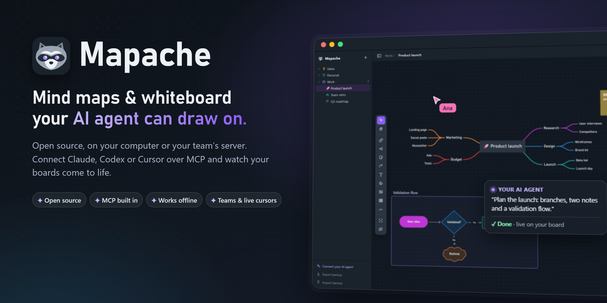
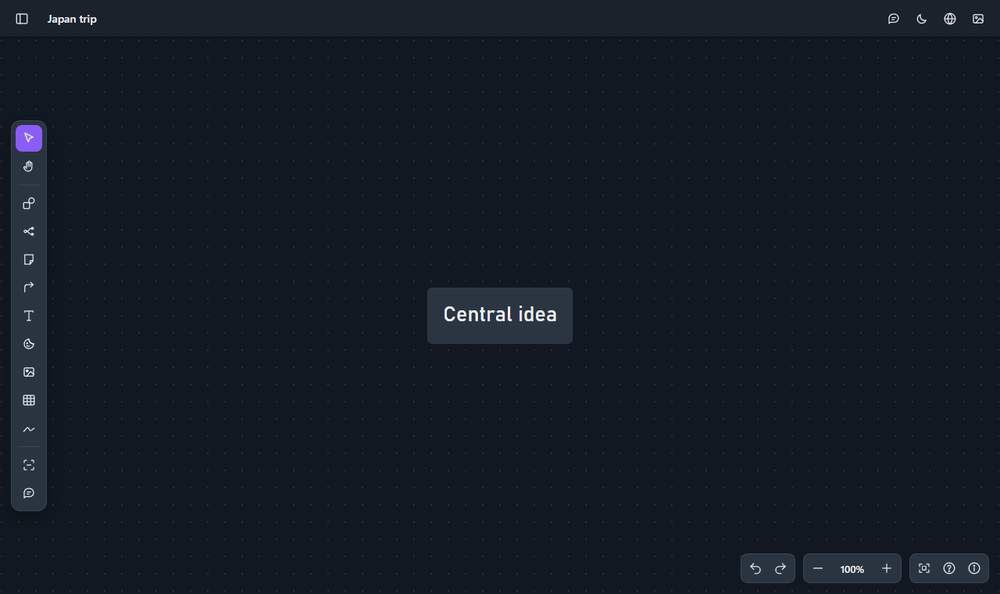
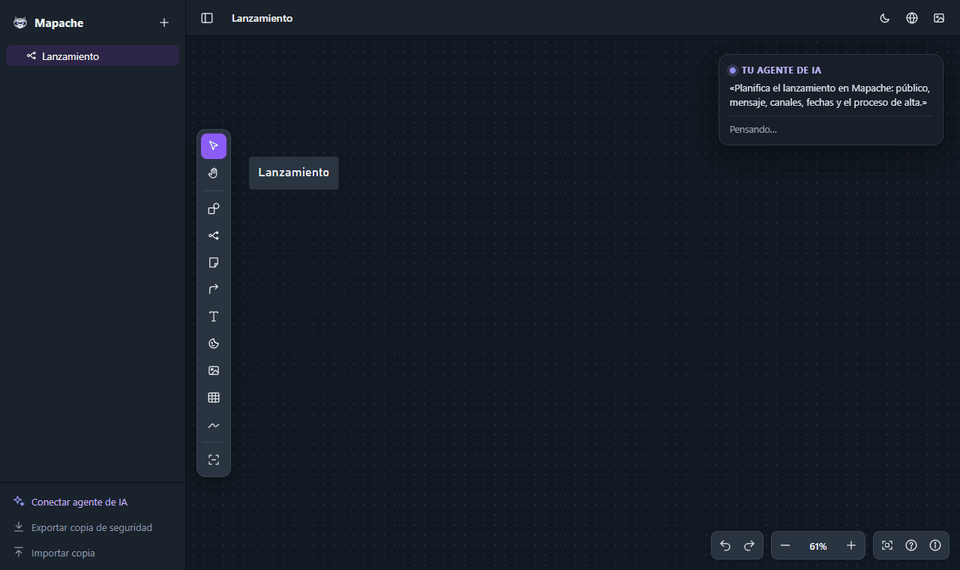
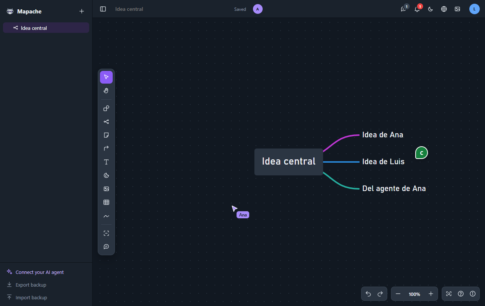
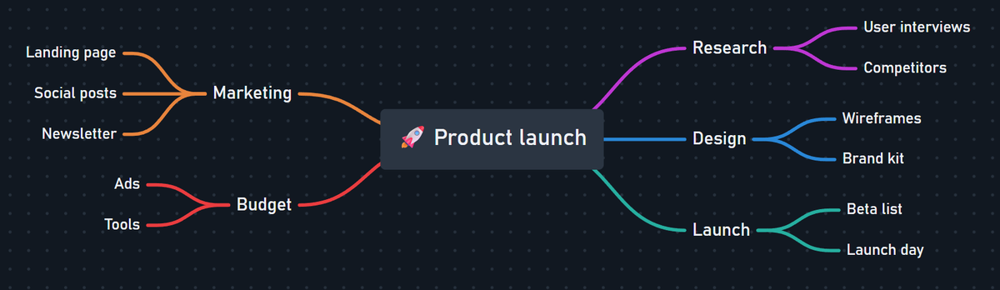
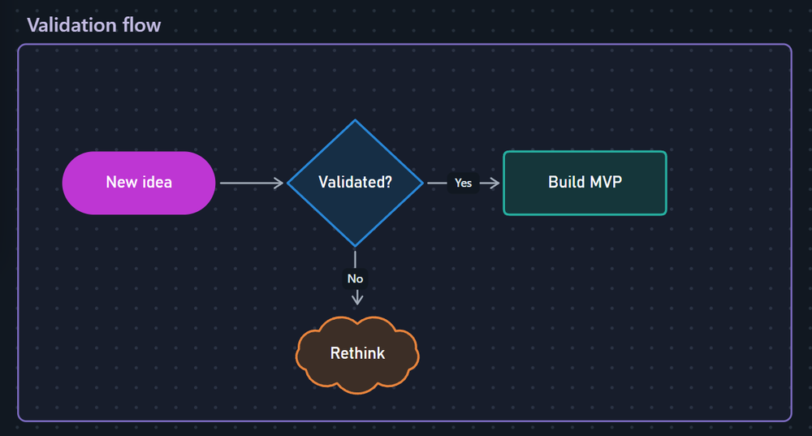
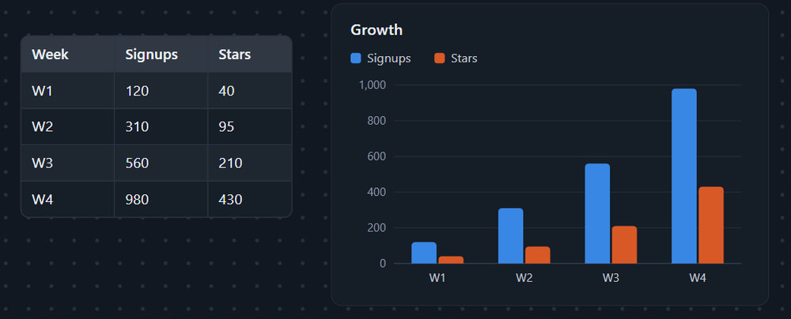
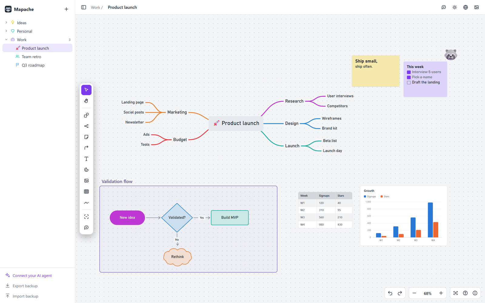

<p align="center">
  
</p>

<h3 align="center">Mapas mentales y pizarra infinita en tu ordenador, y tu agente de IA también puede dibujar en ella.<br>Código abierto. Funciona sin conexión. Sin cuentas.</h3>

<p align="center">
  <a href="#-empezar"><b>Empezar</b></a> ·
  <a href="#-tu-agente-de-ia-tambi%C3%A9n-puede-usarlo">Agentes de IA (MCP)</a> ·
  <a href="#-para-equipos-beta">Equipos</a> ·
  <a href="#-funciones">Funciones</a> ·
  <a href="#gu%C3%ADa-de-uso">Guía de uso</a> ·
  <a href="#%EF%B8%8F-hoja-de-ruta">Hoja de ruta</a> ·
  <a href="README.md">English</a>
</p>

<p align="center">
  <a href="https://github.com/Hackeatutiempo/mapache/actions/workflows/test.yml"></a>
  <a href="LICENSE"></a>
  <a href="#-tu-agente-de-ia-tambi%C3%A9n-puede-usarlo"></a>
  
  
  <a href="#-contribuir"></a>
  <a href="https://github.com/Hackeatutiempo/mapache/stargazers"></a>
</p>

<p align="center">
  
</p>

---

## Por qué Mapache

Casi todas las pizarras te piden una cuenta, una cuota al mes y una copia de tus ideas en sus servidores.
**Mapache es una carpeta que ejecutas en tu ordenador.** Tus tableros son archivos en tu disco, abre al instante,
funciona hasta en un avión y **tu agente de IA puede leerlos y trabajar en ellos contigo**.

- ⚡ **Rápido como una app de escritorio.** Sin frameworks, sin compilar, sin pantallas de carga.
- 🧠 **Mapas mentales que van a tu ritmo.** Tab para un hijo, Enter para un hermano, arrastrar para cambiar de
  rama, colores por rama y tantos mapas como quieras en un tablero.
- 🎨 **Una pizarra de verdad alrededor.** Notas, 12 formas, secciones, conectores que rodean los objetos, dibujo
  a mano con detección de formas, imágenes y vídeos.
- 📊 **Datos incluidos.** Pega una tabla de Excel o Google Sheets y conviértela en cualquiera de 17 gráficos.
- 💬 **Comentarios y menciones.** Deja un comentario en cualquier punto o en cualquier objeto, responde, resuélvelo y
  menciona a alguien con @ (o deja que tu agente te deje notas para revisar).
- 🤖 **Hecho para agentes de IA.** Su servidor MCP permite que Claude, Codex, Cursor y compañía lean tus tableros y
  creen mapas mentales, notas, diagramas y tablas. Los ves aparecer en directo.
- 🔒 **Tuyo de verdad.** Primero en local, sin telemetría y en archivos JSON que puedes leer, copiar o guardar en Git. AGPL-3.0.

|  | **Mapache** | Pizarra en la nube típica |
|---|:---:|:---:|
| Precio | **Gratis** | Plan gratis y luego por usuario |
| Necesita cuenta | **No** | Sí |
| Dónde están tus tableros | **Archivos en tu ordenador** | Su nube |
| Sin conexión | **Sí** | Limitado |
| Tu agente de IA puede leer y editar tableros | **Sí, en local (MCP)** | Desde su nube, si acaso |
| Servidor para equipos con cuentas y cursores en directo | **Sí, en tu servidor con Docker** | Su nube, por usuario |
| Código abierto y autoalojable | **Sí** | No |
| Dependencias que instalar | **0** | — |

## 🤖 Que lo instale tu agente de IA

¿No eres técnico? Pásale esto a tu agente de IA (Claude Code, Codex, Cursor…) y lo hace todo por ti:

```text
Instálame Mapache siguiendo https://github.com/Hackeatutiempo/mapache/blob/main/AGENTS.md,
conéctalo contigo como servidor MCP y déjame un acceso directo para abrirlo con doble clic.
```

La guía paso a paso para agentes está en [AGENTS.md](AGENTS.md): comprueba Node.js, descarga el código, lo arranca,
crea un acceso directo en el escritorio, conecta el servidor MCP y explica dónde se guardan tus tableros.

## 🚀 Empezar

Solo necesitas [Node.js](https://nodejs.org) 18 o posterior. No hay nada más que instalar.

```bash
git clone https://github.com/Hackeatutiempo/mapache.git
cd mapache
npm start
```

Abre **<http://localhost:4321>** y a pensar. Las siguientes veces, doble clic en `Abrir Mapache.cmd` (Windows) o
`./start.sh` (macOS y Linux): arrancan Mapache en segundo plano si hace falta y abren el navegador.

> **Consejo:** en Chrome o Edge elige *Instalar aplicación* en la barra de direcciones. Mapache tendrá su propia
> ventana e icono y funcionará aunque el servidor esté apagado; tus cambios pasan a tus archivos en cuanto vuelve.

Tus tableros se guardan solos como archivos JSON en `~/.mapache` (con `node bin/mapache.js where` ves la carpeta
exacta). **Exportar copia de seguridad** (abajo a la izquierda) te sigue dando todo en un solo archivo.

## 🤖 Tu agente de IA también puede usarlo

Mapache trae un **servidor MCP** (el estándar abierto con el que los agentes de IA usan herramientas) y una **línea de
comandos**. Conéctalo una vez y pide cosas como:

> *«Convierte mis notas de la reunión de hoy en un mapa mental en Mapache.»*<br>
> *«Lee el tablero que tengo abierto y añade una rama de riesgos con tres ideas en cada una.»*<br>
> *«Dibuja el proceso de alta como diagrama de flujo, con una decisión para usuarios de pago y gratis.»*<br>
> *«Pon estas cifras de ventas en una tabla de mi tablero del T4 y añade un gráfico de columnas.»*

<p align="center"></p>

Si tienes Mapache abierto en el navegador, los cambios aparecen **en directo** y **Ctrl+Z** los deshace. Todo pasa en tu
ordenador: el servidor MCP lee y escribe los mismos archivos que usa la app.

Lo más fácil: en la app, pulsa **Conectar agente de IA** (abajo a la izquierda) y copia el texto en tu agente. O
conéctalo tú (cambia la ruta por donde instalaste Mapache; `node bin/mapache.js mcp-config` te las da con tus rutas reales):

| Agente | Cómo conectarlo |
|---|---|
| **Claude Code** | `claude mcp add --scope user mapache -- node ~/Mapache/bin/mapache.js mcp` |
| **Claude Desktop** | *Ajustes > Desarrollador > Editar configuración* y añade el JSON de abajo |
| **Codex** (OpenAI, incluido en los planes de ChatGPT) | `codex mcp add mapache -- node ~/Mapache/bin/mapache.js mcp` |
| **Gemini CLI** | `gemini mcp add mapache node ~/Mapache/bin/mapache.js mcp` |
| **Cursor**, **Windsurf** | añade el JSON de abajo a `~/.cursor/mcp.json` o `~/.codeium/windsurf/mcp_config.json` |
| **VS Code** | *MCP: Open User Configuration* y añade `"mapache": { "type": "stdio", "command": "node", "args": ["~/Mapache/bin/mapache.js", "mcp"] }` dentro de `servers` |
| **ChatGPT** (web o móvil) | No llega solo a tu ordenador. Usa Codex, o un puente como [Desktop Commander](https://desktopcommander.app), y pídele a ChatGPT que use la línea de comandos `mapache` |

```json
{ "mcpServers": { "mapache": { "command": "node", "args": ["/ruta/completa/a/Mapache/bin/mapache.js", "mcp"] } } }
```

Las herramientas que recibe el agente y la línea de comandos están explicadas en el [README en inglés](README.md#-your-ai-agent-can-use-it-too)
y en `node bin/mapache.js help`.

## 👥 Para equipos (beta)

Monta un Mapache para todo tu equipo en vuestro propio servidor: **cuentas con email y contraseña, enlaces de
invitación, roles (admin, puede editar, solo ver), cursores en directo y quién está en cada tablero**, y cada cambio en
la pantalla de todos al momento. Cada persona puede conectar su propio agente de IA con un token personal.

<p align="center"></p>

```bash
git clone https://github.com/Hackeatutiempo/mapache.git && cd mapache
docker compose up -d          # abre http://<servidor>:4321 y usa el código que sale en: docker logs mapache
```

Con dominio, `docker compose --profile https up -d` añade HTTPS automático. Todo está en [TEAM.md](TEAM.md) (en inglés).
El modo equipo es nuevo: pruébalo con tu equipo y [cuéntanos](https://github.com/Hackeatutiempo/mapache/issues) qué falla.

## ✨ Funciones

### Mapas mentales que crecen tan rápido como piensas
<p align="center"></p>

### Diagramas de flujo con conectores que se colocan solos
<p align="center"></p>

### Tus datos, en gráficos
<p align="center"></p>

### Compártelo con quien quieras
Exporta un tablero como **una sola página web**: mándala por email o por chat y se abre en cualquier navegador, con
zoom y desplazamiento, sin instalar nada. O como PDF, PNG o SVG. Tu agente también puede hacerlo («guárdame este
tablero en PDF en el escritorio»).

### Claro u oscuro, como prefieras
<p align="center"></p>

## Guía de uso

### Mapas mentales

- Selecciona un nodo y pulsa los **puntos morados**: el de fuera crea un hijo, el de abajo un hermano.
- **Tab** hijo · **Enter** editar (y al escribir, Enter crea hermano) · **Alt+Enter** padre ·
  **Ctrl+Enter** hermano encima · **Alt+flechas** añadir en esa dirección
- **Ctrl+/** plegar · **Ctrl+D** duplicar · **Supr** borrar · **Ctrl+Alt+[ / ]** subir/bajar nivel
- Al empezar a escribir: `* ` viñetas, `1. ` numerada, `_ ` checklist, `# ` título
- Arrastra un nodo: el mapa enseña en vivo dónde caerá. Más allá del borde de un nodo = hijo suyo.
- Pega un esquema con sangrías (Ctrl+V) y se convierte en ramas.
- **Arrastrar la raíz** mueve el mapa entero; para desplazar la vista, usa la rueda o Espacio + arrastrar.

### Seleccionar varios

Arrastra sobre el fondo: el recuadro selecciona todo lo que toca (objetos, conectores, trazos y nodos de los
mapas; si toca la raíz, el mapa entero; las secciones, solo si quedan dentro del todo). **Shift+clic** añade o quita, **Ctrl+A** selecciona todo. Con varios
elegidos: arrástralos juntos, flechas para moverlos, **Supr** borrar, **Ctrl+D** duplicar, **Ctrl+C / V** copiar y
pegar, y las **esquinas del marco** para escalarlos. En su barra: filtrar por tipo, **organizar** (en cuadrícula, como
árbol o como mapa mental siguiendo las flechas), alinear, repartir, bloquear y meter en sección.

### Menú del clic derecho

Sobre cualquier objeto, conector, nodo, selección o el propio lienzo: copiar, cortar, duplicar, borrar, copiar y
pegar estilo (**Ctrl+Alt+C / V**), guardar como estilo por defecto, organizar, alinear, bloquear, meter en sección,
ajustar a la cuadrícula y **copiar enlace a esta posición** (abre ese mapa centrado en ese punto). En el lienzo vacío,
pegar y añadir notas, formas, texto, stickers, tablas o secciones justo ahí.

**Bloquear (Shift+L):** el objeto no se mueve, no se edita, no se borra y no entra en el recuadro. Clic en él
para desbloquearlo.

### Varios mapas en un tablero

Con el botón **Mapa mental** de la barra (o la tecla **M**) añades otro mapa donde quieras. Cada uno tiene su
disposición (horizontal o vertical), su tipo de línea y su posición; se mueven arrastrando su raíz y puedes pasar
ramas de uno a otro. Supr en la raíz de un mapa añadido lo borra entero.

### Carpetas

Con el **+** de la barra lateral creas mapas o carpetas. Las carpetas se anidan; cada fila tiene un menú **⋯**
(o clic derecho) para renombrar, mover, duplicar o borrar. Arrastra mapas y carpetas para moverlos.
Borrar una carpeta no borra sus mapas: pasan a la carpeta de arriba. Con **Personalizar…** (en ⋯ o clic derecho) eliges color e icono
(de línea o emoji) para cada carpeta y cada mapa.

### Objetos del lienzo

La barra vertical de la izquierda añade objetos libres: pulsa la herramienta y luego el lienzo, o arrastra el
botón hasta donde lo quieras.

- **Nota (N):** crece con el texto, Enter es salto de línea, tirador para cambiar el tamaño, color en su
  barra (el último color se recuerda) y puntos o **Alt+flechas** para crear la siguiente nota al lado.
- **Texto (T):** tamaños S, M, L y XL y color. Si lo dejas vacío, desaparece.
- **Sticker (X):** elige un emoji y cambia su tamaño con el tirador.
- **Medio (I): imagen o vídeo.** Desde el botón, arrastrando archivos al lienzo o con Ctrl+V (también capturas de
  pantalla). Las imágenes se guardan dentro del mapa, reducidas a 1600 px; los vídeos, aparte en el navegador (hasta
  500 MB) y van en la copia de seguridad. Pega un enlace de YouTube, Vimeo, Loom o un .mp4 y se inserta su reproductor.
  Selecciona un vídeo para usar sus controles; clic encima para reproducir o pausar.
- **Formas (R):** rectángulo, píldora, óvalo, rombo, paralelogramos, trapecio, triángulo, hexágono, cilindro,
  nube y estrella. Atajos R, U, O, D, A, G, Y, J. Llevan texto dentro (Enter para escribir), se cambian de tipo
  sin perder el estilo, tienen color, estilo (relleno, borde, discontinuo o transparente) y giro de 90°. Cada
  tipo recuerda su último color y estilo.
- **Secciones (.):** áreas con nombre para agrupar. Se cogen por el título o el borde y se llevan todo lo que
  tienen dentro, incluido el mapa si cabe entero. Contorno o relleno, 8 colores. «Meter en sección» (en ⋯)
  crea una alrededor del objeto o del mapa.
- **Tablas (E):** elige el tamaño en la cuadrícula, o «Importar CSV…». También se crean **pegando** (Ctrl+V) una
  tabla de Excel, Google Sheets, Word, Notion, Markdown o CSV, o **arrastrando un .csv** al lienzo. Clic en una
  celda la selecciona y otro clic la edita; Tab y Enter avanzan como en una hoja de cálculo (Enter al final crea
  fila); los **+** de los bordes añaden columna o fila. En su barra: insertar, mover y eliminar filas y columnas,
  ordenar por la columna activa, encabezado, filas alternas, color y exportar CSV (formato Excel en español).
- **Gráficos:** desde la barra de una tabla, «Crear gráfico». Quedan enlazados: cambian al editar la tabla.
  17 tipos: columnas (normales, apiladas, 100 %), barras (normales, apiladas), líneas, área (normal, apilada),
  circular, anillo, dispersión, burbujas, radar, embudo, mapa de calor, cascada y cifra destacada. En su barra:
  tipo, qué columnas usar (etiquetas y series), título y valores. Al pasar el ratón se ven los datos.
- **Conectores (C):** arrastra de un objeto a otro (formas, notas, tablas, gráficos, imágenes o nodos del mapa).
  Salen y entran siempre por el lado en que los creaste; al mover los objetos, el recorrido se adapta rodeándolos
  sin atravesarlos. En una forma
  seleccionada, sus puntos crean otra forma ya conectada (clic) o un conector (arrastrar). En su barra: texto
  (doble clic), color, continua/discontinua/gruesa, 8 tipos de punta en cada extremo, invertir y trazado en codo,
  curvo o recto. Arrastra cualquier tramo de la línea para darle la forma que quieras (si el tramo va pegado a un
  objeto, aparece un codo nuevo), sus extremos para reconectarlos y el texto para deslizarlo. Ctrl+clic en un
  extremo salta al otro.
- **Dibujo a mano (H):** rotulador fino o grueso, subrayador (Shift+H), goma (E) y lazo (S) para elegir trazos
  y cambiarles el color o el grosor. «Detectar formas» convierte líneas, rectángulos, círculos y rombos hechos a
  mano en formas regulares. Esc para salir.
- En **⋯** de cada objeto: traer al frente o enviar detrás del mapa. Flechas para moverlo con precisión.
- **Guías:** al arrastrar, los bordes y el centro se ajustan a los de lo que hay cerca (objetos y nodos) y se ve una
  línea naranja. Mantén **Alt** para moverlo libremente.
- **Formato del texto:** título, lista o checklist se aplican a las líneas seleccionadas; color, resaltado, negrita,
  cursiva y enlace, a lo seleccionado. Las notas, textos y formas también se alinean a la izquierda, centro o derecha.
  Las formas crecen con su texto.
- **Exportar y compartir:** el botón de imagen de arriba a la derecha guarda el tablero como página web para compartir
  (un solo archivo .html que se abre en cualquier navegador), PDF, PNG o SVG.
- **Comentarios (K):** clic en el lienzo o en un objeto para dejar un comentario; responde, resuelve y menciona con @.
  El botón de comentarios (arriba a la derecha) los lista y la campana avisa de tus menciones.
- **Tema:** botón de sol o luna arriba a la derecha (oscuro, claro o según el sistema).
- **Idioma:** español o inglés, según tu navegador; se cambia con el botón del globo, junto al del tema.

Pulsa **?** dentro de la app para ver todos los atajos.

## 🗺️ Hoja de ruta

- [x] Mapas mentales, objetos de pizarra, tablas y gráficos
- [x] Conectores, dibujo a mano, medios, selección múltiple y guías
- [x] Interfaz en inglés
- [x] Tableros como archivos en tu ordenador, sincronizados en directo entre pestañas y navegadores
- [x] Servidor MCP y línea de comandos para que los agentes de IA lean y editen tableros
- [x] Compartir un tablero como una sola página web, PDF, PNG o SVG
- [x] Servidor para equipos con Docker: cuentas, roles y enlaces de invitación
- [x] Colaboración en tiempo real: cambios, cursores y presencia en directo, cambios simultáneos fusionados, sin conexión también
- [x] Comentarios y menciones

¿Tienes una idea? [Abre una incidencia](https://github.com/Hackeatutiempo/mapache/issues).

## 🔐 Privacidad

Sin cuentas, sin analítica y sin servidores que no sean tuyos. Los tableros son archivos JSON en `~/.mapache`, en tu
ordenador, con una copia en el navegador para que la app funcione sin conexión. El servidor local solo escucha en tu
propio ordenador y rechaza peticiones de otras webs. El servidor MCP también se ejecuta en tu ordenador; el proveedor
de tu agente ve lo que el agente lee, como con cualquier otra herramienta que le des.

<details>
<summary><b>Cómo está hecho</b></summary>

JavaScript sin frameworks ni compilación: el navegador ejecuta exactamente el código que lees. La tabla de
archivos está en el [README en inglés](README.md) y las decisiones de diseño en [DESIGN.md](DESIGN.md).
Los tests se lanzan con `npm test`.

</details>

## 🤝 Contribuir

Las incidencias y las pull requests son bienvenidas, desde una errata hasta una función entera. Evita añadir
dependencias si puedes, sigue el estilo del código de alrededor y añade un test en `test/` si tocas geometría o
lectura de datos o sincronización. Traducir la interfaz a más idiomas es una gran primera contribución (ver `src/i18n.js`).

## ⭐ Apoya el proyecto

Si Mapache te ahorra tiempo, **una estrella ayuda a que otras personas lo encuentren.** La primera vez que lo
arrancas con `npm start` en una terminal te pregunta una sola vez si quieres darla (solo si dices que sí, con tu
propia sesión del CLI de GitHub).

## 📄 Licencia

[GNU AGPL-3.0](LICENSE). Úsalo, cámbialo e instálalo en tu servidor gratis. Si ofreces una versión modificada
como servicio a otras personas, comparte tus cambios con la misma licencia.

---

<p align="center">
  Hecho con 🦝 por <b>Cristian</b> · <a href="https://hackeatutiempo.com">Hackea Tu Tiempo</a> ·
  <a href="https://www.instagram.com/hackeatutiempo/">Instagram</a>
</p>
