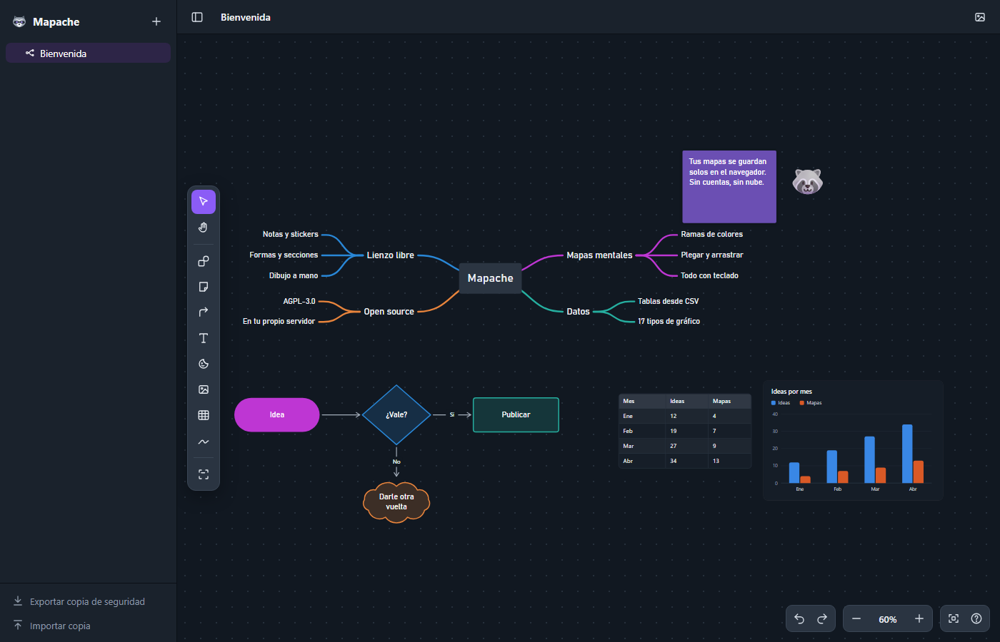

<p align="center"></p>

<h1 align="center">Mapache</h1>

<p align="center"><b>The raccoon that tidies up your ideas.</b><br>
Open-source mind maps and infinite whiteboard that run in your browser. No account, no cloud, no tracking.</p>

<p align="center"><a href="README.es.md">Leer en español</a></p>



## Why Mapache

- **Fast mind maps.** Quick-add dots, colored branches, collapse with a counter, drag branches and watch
  the map re-flow live, and a keyboard shortcut for everything.
- **A whole whiteboard around them.** Sticky notes, text, emoji stickers, images, 12 shapes, sections,
  connectors and freehand drawing.
- **Data, too.** Paste a table from Excel, Google Sheets, Notion or Markdown (or drop a CSV) and turn it
  into any of 17 chart types that stay linked to the table.
- **Yours.** Maps live in your browser (IndexedDB) and work offline once installed. Export a backup
  whenever you want. AGPL-3.0, no telemetry.

## Get started

You only need [Node.js](https://nodejs.org) 18 or newer. There are no dependencies to install.

```bash
git clone https://github.com/Hackeatutiempo/mapache.git
cd mapache
npm start
```

Open <http://localhost:4321>. On Windows you can also double-click `Abrir Mapache.cmd`.

**Tip:** in Chrome or Edge, use *Install app* from the address bar. Mapache gets its own window and icon
and keeps working even when the server is not running.

Your maps are stored in that browser, for that address. Use **Export backup** (bottom left) from time to
time, especially before clearing browser data.

## What's inside

| | |
|---|---|
| **Mind maps** | As many as you want on one board (M). Horizontal or vertical layout, curved or angular lines, branch colors, icons, bullet, numbered and checklist nodes, paste an indented outline to create branches |
| **Notes and text** | Sticky notes that grow with their text, four text sizes, colors. Per-line headings, lists and checklists, plus text color, highlight, bold, italic and links on any selection |
| **Shapes** | Rectangle, pill, oval, diamond, parallelograms, trapezoid, triangle, hexagon, cylinder, cloud, star. Fill, border, dashed or transparent. They grow with their text |
| **Sections** | Named areas that carry their content when you move them |
| **Connectors** | Elbow, curved or straight; nine end caps; labels you can slide along the line; ends keep their side while the path re-routes around objects, and every segment can be dragged to shape it by hand |
| **Freehand** | Pen, highlighter, eraser, lasso, and shape recognition (lines, rectangles, ellipses, diamonds) |
| **Tables** | Paste from spreadsheets, import and export CSV, sort, insert and move rows and columns |
| **Charts** | Column, bar, stacked and 100 %, line, area, pie, donut, scatter, bubble, radar, funnel, heatmap, waterfall and big-number tiles. Color-blind-safe palette |
| **Selection** | Drag on the canvas to select everything the box touches, Shift+click to add, then move, scale, align, distribute, duplicate, copy or delete together. Auto-arrange as a grid, a tree or a mind map following the connectors. Lock objects so they stay put |
| **Right-click menu** | Copy and paste style, save as default style, arrange, align, lock, wrap in section, snap to grid and copy a link to that spot on the board |
| **Folders** | Nested folders and maps in the sidebar, drag to reorganize, a color and an icon (line icon or emoji) for each |
| **Media** | Images and videos (upload, drag or paste), YouTube, Vimeo and Loom links |
| **Guides** | Smart alignment guides snap edges and centers while you drag (hold Alt to skip) |
| **Themes** | Dark, light or follow the system |
| **Export** | PNG image of the board, JSON backup of all maps and folders |

Press **?** inside the app to see every keyboard shortcut.

> The interface is in Spanish for now. An English translation is on the roadmap.

## Roadmap

- [x] Mind maps, whiteboard objects, tables and charts
- [x] Connectors and freehand drawing
- [ ] English interface
- [ ] Self-hosted server with Docker: accounts (email and password), projects and invite links
- [ ] Real-time collaboration (CRDT, keeps working offline)
- [ ] REST API and MCP server so AI agents can read and edit boards
- [ ] Comments and mentions

## Project structure

Plain JavaScript, no build step. Open `src/index.html` through the server and you are running the code you
are reading.

| File | What it does |
|---|---|
| `src/app.js` | State, in-place editing, context bar, menus, dragging, shortcuts |
| `src/layout.js` | Mind map layout and line geometry (pure, tested) |
| `src/connectors.js` | Connector routing |
| `src/ink.js` | Freehand smoothing, eraser, lasso, shape recognition |
| `src/shapes.js` | Shape outlines |
| `src/tables.js` | CSV, TSV, Markdown and HTML table parsing |
| `src/charts.js` | SVG charts |
| `src/sidebar.js` | Folders and map list |
| `src/store.js` | IndexedDB storage |
| `src/sw.js` | Offline support |
| `server.js` | Tiny static server, no dependencies |

The design decisions and measurements are in [DESIGN.md](DESIGN.md).

```bash
npm test
```

If Mapache is useful to you, a ⭐ on GitHub helps other people find it. The first time you run `npm start`
in a terminal it asks once whether you want to star the repo (it only does it if you say yes, using your own
GitHub CLI session).

## Contributing

Issues and pull requests are welcome. Keep it dependency-free where you can, match the style of the
surrounding code, and add a test in `test/` for geometry or parsing changes.

## License

[GNU AGPL-3.0](LICENSE). You can use, modify and self-host Mapache freely. If you run a modified version
as a service for other people, you must share your changes under the same license.
