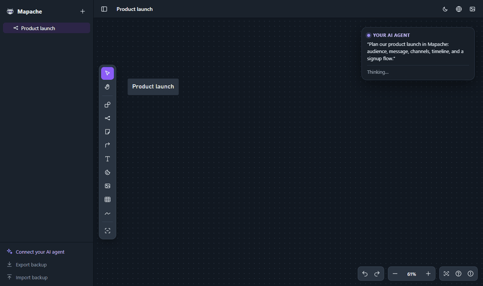

<p align="center">
  
</p>

<h3 align="center">Mind maps and an infinite whiteboard on your computer, and your AI agent can draw on it too.<br>Open source. Works offline. No account.</h3>

<p align="center">
  <a href="#-quick-start"><b>Quick start</b></a> ·
  <a href="#-your-ai-agent-can-use-it-too">AI agents (MCP)</a> ·
  <a href="#-for-teams-beta">Teams</a> ·
  <a href="#-features">Features</a> ·
  <a href="#%EF%B8%8F-keyboard-first">Shortcuts</a> ·
  <a href="#%EF%B8%8F-roadmap">Roadmap</a> ·
  <a href="README.es.md">Español</a>
</p>

<p align="center">
  <a href="https://github.com/Hackeatutiempo/mapache/actions/workflows/test.yml"></a>
  <a href="LICENSE"></a>
  <a href="#-your-ai-agent-can-use-it-too"></a>
  <a href="https://glama.ai/mcp/servers/Hackeatutiempo/mapache"></a>
  
  
  
  <a href="#-contributing"></a>
  <a href="https://github.com/Hackeatutiempo/mapache/stargazers"></a>
</p>

<p align="center">
  
</p>

---

## Why Mapache?

Most whiteboard tools want an account, a monthly fee and a copy of your ideas on their servers.
**Mapache is a folder you run on your own computer.** Your boards are plain files on your disk, it opens instantly,
it keeps working on a plane, and **your AI agent can read them and build on them with you**.

- ⚡ **Fast like a native app.** No framework, no build step, no loading spinners.
- 🧠 **Mind maps that keep up with you.** Tab for a child, Enter for a sibling, drag to re-parent, colored
  branches, and as many maps as you want on one board.
- 🎨 **A real whiteboard around them.** Sticky notes, 12 shapes, sections, connectors that route around
  objects, freehand drawing with shape recognition, images and videos.
- 📊 **Data built in.** Paste a table from Excel or Google Sheets and turn it into any of 17 chart types.
- 💬 **Comments and mentions.** Pin a comment anywhere, reply, resolve, and @mention people (or let your agent leave
  notes for you to review).
- 🤖 **Made for AI agents.** A built-in MCP server lets Claude, Codex, Cursor and friends read your boards and create
  mind maps, notes, flowcharts and tables. You watch them appear live.
- 🔒 **Yours, for real.** Local-first, no telemetry, plain JSON files you can read, back up or put in Git. AGPL-3.0.

|  | **Mapache** | Typical SaaS whiteboard |
|---|:---:|:---:|
| Price | **Free** | Free tier, then per seat |
| Account required | **No** | Yes |
| Where your boards live | **Files on your computer** | Their cloud |
| Works offline | **Yes** | Limited |
| Your AI agent can read and edit boards | **Yes, locally (MCP)** | Through their cloud, if at all |
| Team server with accounts and live cursors | **Yes, self-hosted with Docker** | Their cloud, per seat |
| Open source and self-hostable | **Yes** | No |
| Dependencies to install | **0** | — |

## 🤖 Let your AI agent install it

Not technical? Give this to your AI agent (Claude Code, Codex, Cursor…) and it does everything for you:

```text
Install Mapache for me following https://github.com/Hackeatutiempo/mapache/blob/main/AGENTS.md,
connect it to yourself as an MCP server, and leave a shortcut so I can open it with a double-click.
```

The step-by-step guide for agents lives in [AGENTS.md](AGENTS.md): it checks Node.js, gets the code, starts it,
creates a desktop shortcut, connects the MCP server and explains where your boards are saved.

## 🚀 Quick start

All you need is [Node.js](https://nodejs.org) 18 or newer. There is nothing else to install.

```bash
git clone https://github.com/Hackeatutiempo/mapache.git
cd mapache
npm start
```

Open **<http://localhost:4321>** and start thinking. Next time, double-click `Abrir Mapache.cmd` (Windows) or run
`./start.sh` (macOS and Linux): they start Mapache in the background if needed and open the browser.

> **Tip:** in Chrome or Edge choose *Install app* in the address bar. Mapache gets its own window and icon and
> works even when the server is off; your changes sync to your files as soon as it is back.

Your boards are saved automatically as JSON files in `~/.mapache` (run `node bin/mapache.js where` to see the exact
folder). **Export backup** (bottom left) still gives you everything in one file.

When a new version comes out, Mapache tells you in the app. Update with `node bin/mapache.js update` (or ask your
agent to "update Mapache"): it downloads it and restarts Mapache, and your boards are not touched.

## 🤖 Your AI agent can use it too

Mapache ships with an **MCP server** (the open standard that lets AI agents use tools) and a **command line**.
Connect it once and ask things like:

> *"Turn my notes from today's meeting into a mind map in Mapache."*<br>
> *"Read the board I have open and add a risks branch with three ideas under each one."*<br>
> *"Draw the onboarding flow as a flowchart with a decision for paid and free users."*<br>
> *"Put these sales numbers in a table on my Q4 board and add a column chart."*

<p align="center"></p>

If Mapache is open in your browser, the changes appear **live**, and **Ctrl+Z** undoes them. Everything runs on your
computer: the MCP server reads and writes the same files the app uses.

The easiest way: in the app, click **Connect your AI agent** (bottom left) and copy the prompt into your agent. Or
connect it yourself (replace the path with where you installed Mapache; `node bin/mapache.js mcp-config` prints
these with your real paths):

| Agent | How to connect |
|---|---|
| **Claude Code** | `claude mcp add --scope user mapache -- node ~/Mapache/bin/mapache.js mcp` |
| **Claude Desktop** | *Settings > Developer > Edit config*, then add the JSON below |
| **Codex** (OpenAI, included with ChatGPT plans) | `codex mcp add mapache -- node ~/Mapache/bin/mapache.js mcp` |
| **Gemini CLI** | `gemini mcp add mapache node ~/Mapache/bin/mapache.js mcp` |
| **Cursor**, **Windsurf** | add the JSON below to `~/.cursor/mcp.json` or `~/.codeium/windsurf/mcp_config.json` |
| **VS Code** | *MCP: Open User Configuration*, add `"mapache": { "type": "stdio", "command": "node", "args": ["~/Mapache/bin/mapache.js", "mcp"] }` under `servers` |
| **ChatGPT** (web or phone) | It cannot reach your computer on its own. Use Codex, or a bridge such as [Desktop Commander](https://desktopcommander.app), and ask ChatGPT to use the `mapache` command line |

```json
{ "mcpServers": { "mapache": { "command": "node", "args": ["/full/path/to/Mapache/bin/mapache.js", "mcp"] } } }
```

<details>
<summary><b>Tools the agent gets</b></summary>

| Tool | What it does |
|---|---|
| `list_boards`, `read_board`, `search_boards` | See every board and read one as an outline, with ids |
| `create_board`, `update_board`, `delete_board`, `create_folder` | Organize boards (deleting moves them to the trash) |
| `add_nodes`, `update_nodes`, `move_node`, `delete_nodes`, `add_mindmap` | Grow and edit mind maps from indented outlines |
| `add_items`, `update_items`, `delete_items` | Sticky notes, text, shapes, sections, stickers, tables, charts and video embeds |
| `connect` | Arrows between anything, with labels |
| `view_images` | See what the images on a board show (screenshots, slides, photos) |
| `list_comments`, `add_comment`, `reply_comment`, `resolve_comment` | Read and write comments, with @mentions |
| `export_board` | Save a board as a shareable web page, PDF, PNG or SVG |
| `open_board` | Show a board in the browser |

Agents write simple Markdown (`# heading`, `- bullet`, `[ ] task`, `**bold**`, links) and new content is placed in free
space automatically. `"open"` always means the board you are looking at.

</details>

<details>
<summary><b>Command line</b></summary>

```bash
node bin/mapache.js help                      # everything it can do
node bin/mapache.js list                      # boards and folders
node bin/mapache.js show open                 # the board open in the app, as an outline
node bin/mapache.js new "Launch plan" --outline @plan.txt
node bin/mapache.js add open "Marketing" "Webinar" "Podcast"
node bin/mapache.js tool add_items '{"board":"open","items":[{"type":"note","text":"Call Ana"}]}'
node bin/mapache.js export open --format pdf  # save the open board as a PDF in Downloads
node bin/mapache.js start | stop | status | open
node bin/mapache.js autostart on              # start Mapache when you log in
```

Run `npm link` inside the folder once to get a global `mapache` command.

</details>

## 👥 For teams (beta)

Run one Mapache for your whole team on your own server: **accounts with email and password, invitation links, roles
(admin, can edit, can view), live cursors and avatars of who is on each board**, and every change on everyone's
screen as it happens. Each person can connect their own AI agent with a personal token.

<p align="center"></p>

```bash
git clone https://github.com/Hackeatutiempo/mapache.git && cd mapache
docker compose up -d          # then open http://<server>:4321 and use the setup code from: docker logs mapache
```

With a domain, `docker compose --profile https up -d` adds automatic HTTPS. Everything is in [TEAM.md](TEAM.md).
Team mode is new: try it with your team and [tell us](https://github.com/Hackeatutiempo/mapache/issues) what breaks.

## ✨ Features

### Mind maps that grow as fast as you think
Quick-add dots, Tab and Enter, drag a branch and watch the map re-flow live, collapse with a counter,
horizontal or vertical layouts, curved or angular lines. Paste an indented outline and it becomes a map.

<p align="center"></p>

### Flowcharts with connectors that route themselves
Connect shapes, notes, tables or mind map nodes. Ends keep their side while the path re-routes around
objects; drag any segment to shape it by hand. Elbow, curved or straight, with labels and nine end caps.

<p align="center"></p>

### Your data, as charts
Paste from Excel, Google Sheets, Notion or Markdown, or drop a CSV. Charts stay linked to their table and
update while you type. Color-blind-safe palettes in light and dark mode.

<p align="center"></p>

### Share it with anyone
Export a board as **a single web page**: send it by email or chat and it opens in any browser, with zoom and pan,
nothing to install. Or as PDF, PNG or SVG. Your agent can do it too ("save this board as a PDF on my desktop").

### Light or dark, your call
<p align="center"></p>

<details>
<summary><b>Everything that is inside</b></summary>

| | |
|---|---|
| **Mind maps** | As many as you want on one board (M). Horizontal or vertical layout, curved or angular lines, branch colors, icons, bullet, numbered and checklist nodes, paste an indented outline to create branches |
| **Notes and text** | Sticky notes that grow with their text, four text sizes, colors. Per-line headings, lists and checklists, plus text color, highlight, bold, italic and links on any selection |
| **Shapes** | Rectangle, pill, oval, diamond, parallelograms, trapezoid, triangle, hexagon, cylinder, cloud, star. Fill, border, dashed or transparent. They grow with their text |
| **Sections** | Named areas that carry their content when you move them |
| **Connectors** | Elbow, curved or straight; nine end caps; labels you can slide along the line; ends keep their side while the path re-routes around objects, and every segment can be dragged |
| **Freehand** | Pen, highlighter, eraser, lasso, and shape recognition (lines, rectangles, ellipses, diamonds) |
| **Tables** | Paste from spreadsheets, import and export CSV, sort, insert and move rows and columns |
| **Charts** | Column, bar, stacked and 100 %, line, area, pie, donut, scatter, bubble, radar, funnel, heatmap, waterfall and big-number tiles |
| **Media** | Images and videos (upload, drag or paste), YouTube, Vimeo and Loom links |
| **Selection** | Drag on the canvas to select what the box touches, Shift+click to add, then move, scale, align, distribute, duplicate, copy or delete together. Auto-arrange as a grid, a tree or a mind map. Lock objects so they stay put |
| **Guides** | Smart alignment guides snap edges and centers while you drag (hold Alt to skip) |
| **Right-click menu** | Copy and paste style, save as default style, arrange, align, lock, wrap in section, snap to grid and copy a link to that spot on the board |
| **Folders** | Nested folders and maps in the sidebar, drag to reorganize, a color and an icon for each |
| **AI agents** | MCP server and command line with 23 tools (it can also see the images on your boards); changes from your agent appear live and can be undone |
| **Comments** | Pins on the board or on any object, threads with replies, resolve, @mentions with a bell for unread ones (K) |
| **Sync** | Boards are files on your computer; every open tab and browser stays in sync, edits made offline sync later, and simultaneous changes are merged |
| **Teams** | Self-hosted team server (Docker): accounts, invitation links, roles, live cursors and presence, personal agent tokens |
| **Languages** | English and Spanish, following your browser (switch any time) |
| **Themes** | Dark, light or follow the system |
| **Share and export** | A single-file web page anyone can open in a browser (zoom and pan, no install), PDF, PNG, SVG, and a JSON backup of all maps, folders and videos |

</details>

## ⌨️ Keyboard-first

| Key | Does |
|---|---|
| `Tab` · `Enter` | Child · sibling (while typing) |
| `M` · `N` · `T` · `R` | New mind map · sticky note · text · shape |
| `C` · `H` · `E` · `I` | Connector · freehand · table · image or video |
| `K` | Comment |
| `Drag on canvas` · `Ctrl A` | Select many · select all |
| `Shift L` · `Ctrl Alt C / V` | Lock · copy and paste style |
| `1` · `0` · `Space + drag` | Fit · 100 % · pan |
| `?` | Every shortcut |

## 🗺️ Roadmap

- [x] Mind maps, whiteboard objects, tables and charts
- [x] Connectors, freehand drawing, media, multi-selection and guides
- [x] English interface
- [x] Boards as local files, live sync between tabs and browsers
- [x] MCP server and command line so AI agents can read and edit boards
- [x] Share a board as a single HTML page, PDF, PNG or SVG
- [x] Self-hosted team server with Docker: accounts, roles and invitation links
- [x] Real-time collaboration: live changes, cursors and presence, merged edits, keeps working offline
- [x] Comments and mentions

Have an idea? [Open an issue](https://github.com/Hackeatutiempo/mapache/issues).

## 🔐 Privacy

There is no account, no analytics and no server you do not run yourself. Boards live as JSON files in `~/.mapache`
on your computer, with a copy in your browser so the app works offline. The local server only listens on your own
computer and refuses requests from other websites. The MCP server runs on your computer too; your agent's provider
sees what the agent reads, as with any other tool you give it. In team mode the boards live on your own server, behind
accounts (see [TEAM.md](TEAM.md#security-notes)).

Once a day the server asks GitHub which is the latest version of Mapache, to tell you when there is a new one. It is an
anonymous request for public information, with nothing about you or your boards. Turn it off with
`MAPACHE_UPDATE_CHECK=off`.

<details>
<summary><b>How it is built</b></summary>

Plain JavaScript, no framework and no build step: the browser runs exactly the code you are reading.

| File | What it does |
|---|---|
| `src/app.js` | State, in-place editing, context bar, menus, dragging, shortcuts |
| `src/layout.js` | Mind map layout and line geometry (pure, tested) |
| `src/connectors.js` | Connector routing |
| `src/arrange.js` | Arrange as grid, tree or mind map |
| `src/ink.js` | Freehand smoothing, eraser, lasso, shape recognition |
| `src/shapes.js` | Shape outlines |
| `src/tables.js` | CSV, TSV, Markdown and HTML table parsing |
| `src/charts.js` | SVG charts |
| `src/sidebar.js` | Folders and map list |
| `src/i18n.js` | English and Spanish |
| `src/store.js` | Browser storage and sync with the files |
| `src/merge.js` | Three-way merge of simultaneous changes |
| `src/sw.js` | Offline support |
| `server.js` | Local server: the app, the files API, live updates and MCP over HTTP |
| `lib/store.js` | Boards as files, with revisions and a trash |
| `lib/board.js` | Board editing for agents: outlines, Markdown, placement |
| `lib/tools.js` · `lib/mcp.js` | The agent tools and the MCP server |
| `lib/auth.js` · `lib/team.js` · `src/team-ui.js` | Team mode: accounts, invitations, roles, presence and cursors |
| `Dockerfile` · `docker-compose.yml` · `Caddyfile` | Team server image, with optional automatic HTTPS |
| `bin/mapache.js` | Command line |

Design decisions and measurements are in [DESIGN.md](DESIGN.md). Run the tests with `npm test`.

</details>

## 🤝 Contributing

Issues and pull requests are welcome, from typo fixes to whole features. Keep it dependency-free where you
can, match the style of the surrounding code, and add a test in `test/` for geometry, parsing or sync changes.
Translations to more languages are a great first contribution (see `src/i18n.js`).

## ⭐ Support the project

If Mapache saves you time, **a star helps other people find it.** The first time you run `npm start` in a
terminal it asks once whether you want to star the repo (only if you say yes, with your own GitHub CLI session).

<p align="center">
  <a href="https://github.com/Hackeatutiempo/mapache/stargazers"></a>
</p>

## 📄 License

[GNU AGPL-3.0](LICENSE). Use it, change it and host it for free. If you offer a modified version as a
service to other people, share your changes under the same license.

---

<p align="center">
  Made with 🦝 by <b>Cristian</b> · <a href="https://hackeatutiempo.com">Hackea Tu Tiempo</a> ·
  <a href="https://www.instagram.com/hackeatutiempo/">Instagram</a>
</p>
